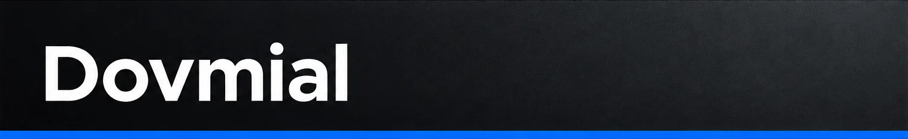

# Software Engineer

I build backend systems and automate business workflows with C# and .NET.

I use AI coding agents to turn specifications into small changes that I verify through automated tests and code review.

I’m interested in software architecture, domain-driven design, and functional programming in C#.

[Email](mailto:nma91@mail.ru) · [Telegram](https://t.me/Dovmial) · [VK](https://vk.com/dovmial)
